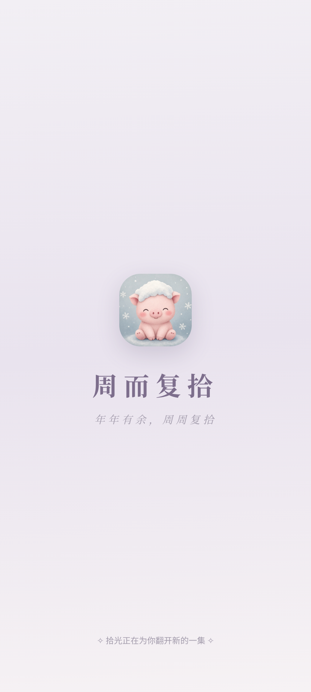
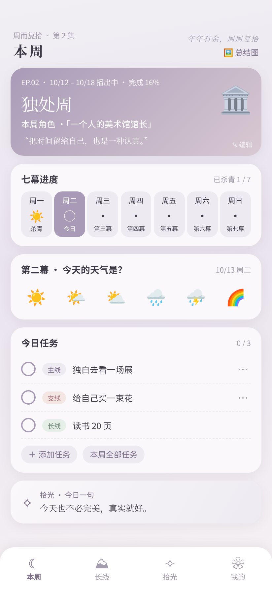
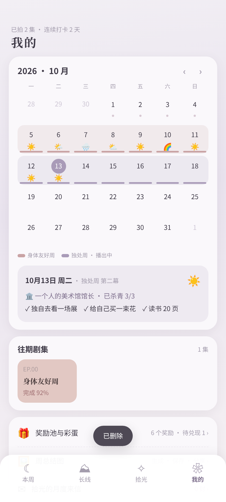
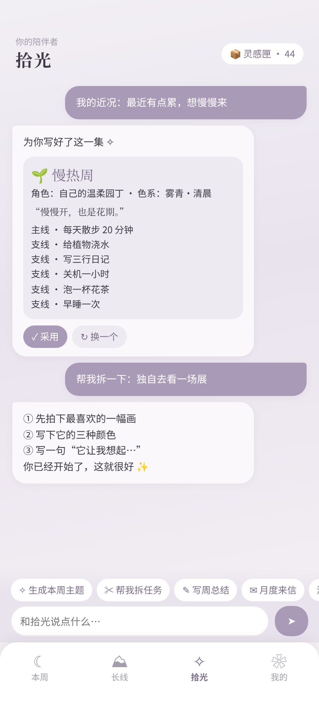
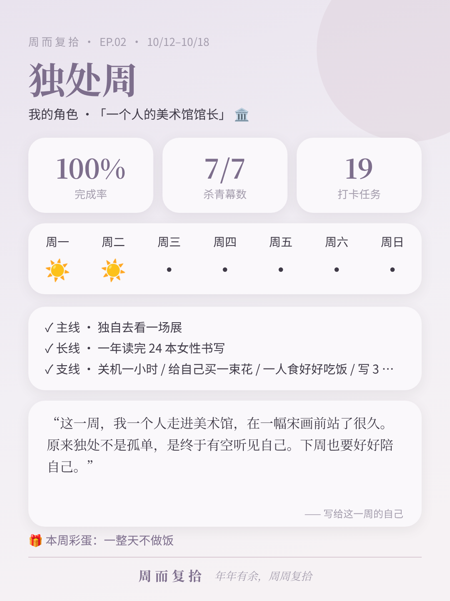

# 周而复拾

> 年年有余，周周复拾。

把生活过成一部剧的主题周 Android App。每周一集，给自己一个主题和角色，每天一幕，用天气记录心情。

- **本周**：主题卡、七幕进度、今日心情、主线 / 长线 / 支线任务
- **长线**：跨周目标，4 / 8 / 12 / 24 周里程碑解锁纪念卡
- **拾光**：AI 陪伴者，生成本周主题、拆任务、写周总结、月度来信（支持 OpenAI / DeepSeek / 通义 / Kimi 等 OpenAI 兼容接口，Key 只存本机）
- **灵感匣**：44 个内置主题，不知道这周做什么就抽一个
- **彩蛋**：自设奖励池，本周完成 ≥80% 拆彩蛋；隐藏小纸条
- **周总结图**：一键生成 1080×1440 小红书风格图，保存相册或分享
- 7 套莫兰迪色，随主题自动换色

## 截图

   

## 安装
1. 在 [Releases](https://github.com/scarlettfh1923-ui/zhouerfushi/releases/latest) 下载 `zhouerfushi-v2.8.apk`
   当前版本：**v2.8**（七幕胶片条、卡片内添加任务、纵向时间轴调整安排）
2. 在手机上打开，按提示允许「安装未知来源应用」
3. 已装 v1 可直接覆盖安装，数据保留

要求 Android 7.0 及以上。AI 功能需在「我的 › AI 设置」自行填写 API Key。
